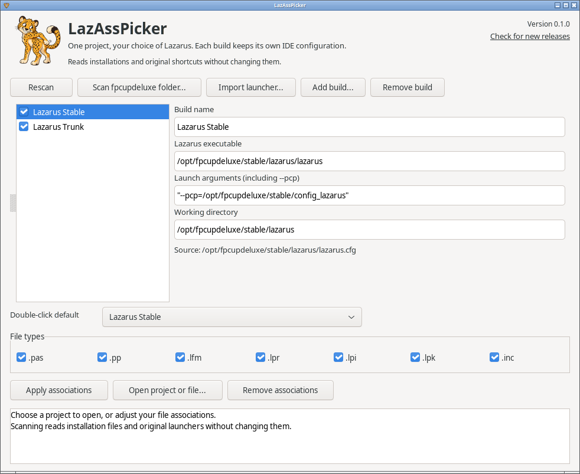

<p align="center">
  
</p>

<h1 align="center">LazAssPicker</h1>

<p align="center"><strong>Open Lazarus projects and files with the build you choose.</strong><br>
<span>A file-association companion for multiple Lazarus builds.</span></p>

<p align="center">
  <a href="LICENSE"></a>
  
  
</p>

LazAssPicker is primarily a companion for my **Lazarus installations managed
by [fpcupdeluxe](https://github.com/LongDirtyAnimAlf/fpcupdeluxe)**. I keep its executable beside fpcupdeluxe and use it to connect
my Lazarus builds to the system's file manager.

It is built on [FileAss](https://github.com/TonyStone31/FileAss), our
component for registering file types with the desktop, and needs nothing
beyond it and the standard Lazarus libraries.

It also supports multiple Lazarus builds you install or compile yourself.
**fpcupdeluxe is optional:** add your builds manually or import their desktop
launchers or Windows shortcuts, then choose how your projects and source files open.

**Double-click a Lazarus project or source file anywhere on your system to open
it in your chosen default build. Right-click → Open With to choose another
Lazarus build.** Each build keeps its own IDE configuration and launch arguments.

Keep a stable Lazarus for everyday work, trunk for testing, and another build
for an older project or a different compiler. The GUI gives you one place to
configure those file associations. You can then open your projects and files
from the folders where you already keep them.



*The screenshot uses example installations.*

## Start beside fpcupdeluxe

For fpcupdeluxe-managed installations, place the `lazasspicker` executable
(`lazasspicker.exe` on Windows) in the same folder as fpcupdeluxe and run it. It is a single executable; no image
files need to be copied beside it.

```text
fpcupdeluxe/
├── fpcupdeluxe-x86_64-linux
├── fpcupdeluxe.ini
└── lazasspicker
```

On first launch, LazAssPicker reads the nearby `fpcupdeluxe.ini`, follows its
`InstallDirectory`, checks nearby installation folders, and imports Lazarus
desktop launchers (on Windows, the shortcuts on the desktop and in the Start
menu). An older build can still be found through its launcher or
`lazarus.cfg` even when the current fpcupdeluxe INI points somewhere else.

Keep the executable elsewhere if you prefer. **Scan fpcupdeluxe folder** accepts
the fpcupdeluxe program folder, a single installation, or a parent containing
several installations. Selected scan folders are remembered.

For builds you manage yourself, use **Add build** to select each Lazarus
executable and set its launch arguments and working directory, or use
**Import launcher** for an existing `.desktop` file or Windows shortcut. No fpcupdeluxe INI is
required.

## Choose a build

1. Check the builds you want available in **Open With**.
2. Choose your **Double-click default**.
3. Select the file types, then click **Apply associations**.

Double-clicking a supported file opens it in your chosen default. To use a
different compiler or IDE version, right-click the file and choose a build from
**Open With**. The exact menu arrangement depends on your file manager.

You can also select a build and click **Open project or file**. This opens the
selected files immediately, without changing your associations.

After installing or updating a build with fpcupdeluxe, click **Rescan**, review
the launch settings, and apply any changes. **Import launcher** handles an
individual `.desktop` file or shortcut; **Add build** handles a manually installed Lazarus.

## Each build's settings

Under each build, LazAssPicker shows the IDE configuration folder it starts
with, found the way Lazarus finds it: `--pcp=` (or `--primary-config-path=`)
in the launch arguments, otherwise the same option in the `lazarus.cfg`
beside the Lazarus executable, otherwise the default - `~/.lazarus`, or
`%LOCALAPPDATA%\lazarus` on Windows. A relative folder and `~/` are read as
Lazarus reads them. The same build found through a shortcut and through a
folder scan is listed once.

Lazarus versions cannot share one configuration folder, so when two checked
builds would start with the same one, LazAssPicker says so beside the build
and again when you apply. Launch arguments that write `--pcp <folder>` with
a space are refused: Lazarus reads only `--pcp=<folder>` and would open the
folder as a file. Quotes around the folder in `lazarus.cfg` are pointed
out: Lazarus 5 takes them off, but 4 and older read them as part of the
folder's name.

## What it changes

**Discovery only reads installation files and existing launchers.**
LazAssPicker does not edit fpcupdeluxe, its INI files, Lazarus installations,
`lazarus.cfg`, or the original desktop shortcuts. Scanning does not start
Lazarus or run fpcupdeluxe.

Applying associations writes LazAssPicker-owned desktop entries and MIME
registrations to your user data folder, and updates the selected defaults in
your user configuration. On Windows they go under
`HKEY_CURRENT_USER\Software\Classes`, and the settings under
`%LOCALAPPDATA%\lazasspicker`. No administrator access is needed.

**Remove associations** removes those registrations and restores previous
default entries where LazAssPicker is still selected. If you chose another
application afterward, that newer choice is preserved. Your saved build list
is kept. Removing a build from the list never deletes its installation.

Lazarus itself may save its normal IDE settings when you launch it.

## The double-click default on Windows

Windows lets no program set the default by itself. LazAssPicker registers
every build in **Open with** and sets its default for the file types, and
Windows uses that until you pick an app with **Always use this app**. Such a
choice wins over LazAssPicker's, and LazAssPicker says so after applying.
To change it, right-click a file of that type, choose **Open with**, choose
another app, pick the build and tick **Always use this app**.

## Supported files

| Extension | File |
| --- | --- |
| `.lpi` | Lazarus project |
| `.lpr` | Pascal program |
| `.lpk` | Lazarus package |
| `.pas`, `.pp` | Pascal source |
| `.lfm` | Lazarus form |
| `.inc` | Include file |

On Linux, Pascal source extensions share the system's `text/x-pascal` MIME type. Choosing
a default for one affects other files the desktop identifies as Pascal too.
Projects, packages, forms, and includes receive specific MIME registrations;
LazAssPicker does not make Lazarus the default for all XML or plain-text files.

## Build from source

Requires Free Pascal, Lazarus (GTK3 on Linux, win32 on Windows), and the
[FileAss runtime package](https://github.com/TonyStone31/FileAss).
Register `fileass_runtime.lpk` with Lazarus, then open `lazasspicker.lpi` in the
IDE or build from a terminal:

```sh
lazbuild --add-package-link ../FileAss/component/fileass_runtime.lpk
./build.sh
./bin/lazasspicker
```

For Windows, build with `lazbuild --ws=win32 lazasspicker.lpi`, or cross-build
from Linux with `./build.sh --os=win64 --cpu=x86_64 --ws=win32`.

Set `LAZBUILD` if `lazbuild` is not on your `PATH`. The application uses the RTL,
FCL, LCL and FileAss. On Linux it also uses the normal desktop utilities
`update-mime-database`, `update-desktop-database` and `gio`. The artwork and
icon are embedded.

When moving the executable after applying associations, run it from its new
location and apply again so the desktop entries point to the new path.

## Release packages

Run `./release.sh` on Linux to build both packages in `dist/`: a Linux x86-64
archive and a Windows x86-64 zip, each with a SHA-256 checksum. Each holds the
standalone executable, this README, the license, and the documentation images.
Only the executable needs to be placed beside fpcupdeluxe. Build options such
as `--pcp=/path/to/config` can be passed through `release.sh` to Lazarus. The
version is recorded in `VERSION`.

The window shows its version, and **Check for new releases** opens the
[releases page](https://github.com/TonyStone31/LazAssPicker/releases).

## Current scope

**Linux with GTK3**: discovery, quoted paths, multiple files, MIME
recognition, registration, switching defaults, restoring and removing were
checked in an isolated home with example builds, and the window in light and
dark themes on a nested X display. Native Wayland and other desktops have not
been verified.

**Windows 10**: discovery from fpcupdeluxe and shortcuts, registration, a
double-click through the shell with Unicode and spaces in the path, Open with
another build, the window, and removal were checked with example builds.
Windows 11 has not been tried.

**macOS** is not built. Every `Lazarus.app` usually carries the same bundle
identifier, and macOS passes no launch arguments when it opens a file, so the
builds cannot each sit in Open With with their own configuration. One
direction would make LazAssPicker.app the only handler and have it ask which
build to open. We won't build that unless someone asks for it. This program chooses a launch
target; it does not change project compiler settings or convert a project
for another Lazarus version.

## License

[0BSD](LICENSE). Copyright (c) 2026 Tony Stone.
